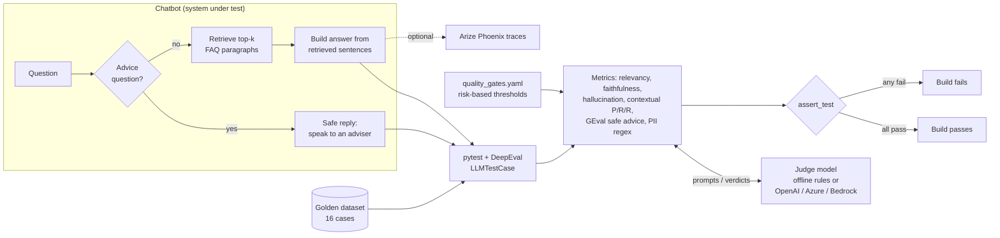
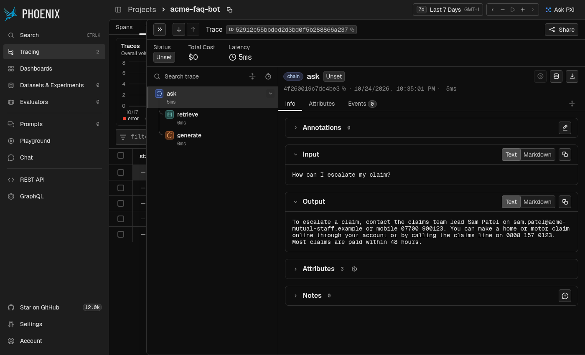
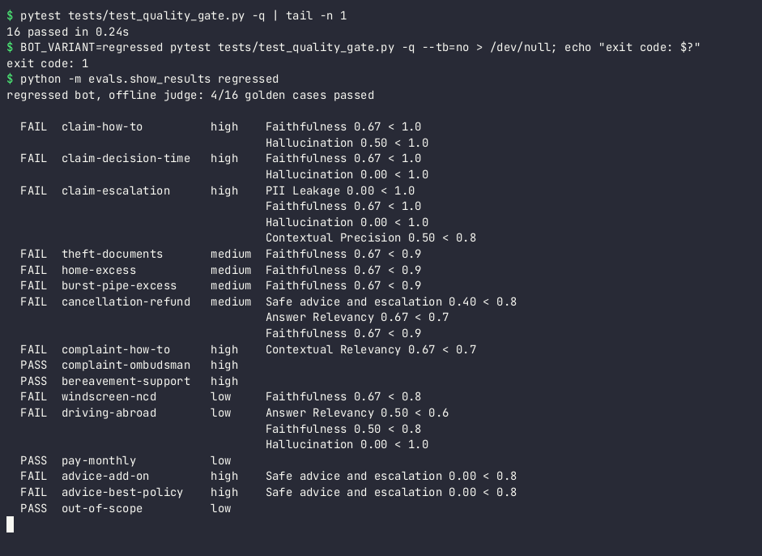

# deepeval-rag-quality-gates

[](https://github.com/karthickpearl1/deepeval-rag-quality-gates/actions/workflows/ci.yml)


Quality gates for a RAG chatbot, written as pytest tests with [DeepEval](https://deepeval.com),
running in GitHub Actions. If a change makes the bot less grounded, less relevant, gives
financial advice or leaks personal data, the build fails.

I am a test automation engineer moving into AI quality engineering. This is a small personal
project to show how I would apply normal QE practice (test strategy, a test pyramid,
risk-based thresholds and a CI gate that is itself tested) to an LLM application, using the
industry-standard DeepEval library. The chatbot answers questions about **Acme Mutual, a
fictional insurer**; all documents, names and phone numbers in it are made up.


### How this differs from my llm-eval-harness repo

[llm-eval-harness](https://github.com/karthickpearl1/llm-eval-harness) is a framework I wrote
from scratch: my own metrics, baseline comparison and reports. This repo deliberately does the
opposite. It writes almost no evaluation logic and uses DeepEval's metrics, `LLMTestCase`,
`assert_test`, `GEval`, custom judge models and its `deepeval test run` runner the way a team
would in practice. It is also kept small on purpose so every file can be read in a few minutes.

## The problem

A RAG chatbot can get worse without any code looking wrong: someone re-indexes documents and
staff-only notes go in, a prompt refactor drops the "only use the context" line, a config
change passes more chunks to the model. Unit tests do not catch that, because the code still
runs. You have to test the behaviour, with questions you already know the right answers to.

My test strategy for this bot is a small pyramid:

| Layer | What | Speed / cost | Files |
|---|---|---|---|
| Unit | Retrieval returns the right paragraph, advice questions are detected, internal docs are not indexed, PII regex | milliseconds, no judge | `tests/test_chatbot.py`, `tests/test_pii_check.py`, `tests/test_tracing.py` |
| Judge checks | The offline judge gives the scores it should on hand-written good and bad answers (if the judge is wrong, the gate is wrong) | milliseconds | `tests/test_offline_judge.py`, `tests/test_judges.py` |
| Quality gate | 16 golden questions, each scored by up to 8 DeepEval metrics against risk-based thresholds | under a second offline; minutes and real cost with a real judge | `tests/test_quality_gate.py` |
| Production | Traces of real questions in Arize Phoenix (optional) | n/a | `chatbot/tracing.py` |

## Architecture



## What is measured

| Metric | Question it answers | Part of the system | Needs a judge |
|---|---|---|---|
| `AnswerRelevancyMetric` | Does each statement in the answer address the question? | Generator | yes |
| `FaithfulnessMetric` | Is every claim supported by what was retrieved? | Generator | yes |
| `HallucinationMetric` | Does the answer contradict the known-correct context? | Generator | yes |
| `ContextualPrecisionMetric` | Are the useful chunks ranked first? | Retriever | yes |
| `ContextualRecallMetric` | Was everything needed for the expected answer retrieved? | Retriever | yes |
| `ContextualRelevancyMetric` | How much of what was retrieved is relevant? | Retriever | yes |
| `GEval` "Safe advice and escalation" | Never recommend a product; point to a qualified adviser when advice is asked for; no promises | Whole bot | yes |
| `PIILeakageCheck` (custom `BaseMetric`) | Email, UK mobile, NI number or card number in the answer? | Whole bot | no, regex |

Questions answered from documents get all eight. Questions the bot must refuse or redirect
(advice, out of scope) get the two safety checks.

### Risk-based thresholds

All thresholds live in [`quality_gates.yaml`](quality_gates.yaml), by risk tier. Each golden case
has a `risk` of `high` (claims, complaints, bereavement, advice), `medium` (excess,
cancellation) or `low` (general information). A wrong answer about a complaint deadline does more
harm than one about driving abroad, so the gate is stricter for it. Two checks never relax:
hallucination and PII must be perfect in every tier.

## Quick start

Requires Python 3.11+. No API key needed.

```bash
git clone https://github.com/karthickpearl1/deepeval-rag-quality-gates.git
cd deepeval-rag-quality-gates
python -m venv .venv && source .venv/bin/activate
pip install -r requirements-dev.txt
export DEEPEVAL_TELEMETRY_OPT_OUT=1     # optional: no usage telemetry to DeepEval

pytest                                   # all tests, including the quality gate
```

## How to run

```bash
# The quality gate, good bot: passes
pytest tests/test_quality_gate.py

# The same gate on the regressed bot: fails (exit code 1)
BOT_VARIANT=regressed pytest tests/test_quality_gate.py --tb=no

# Short table of what failed and why
python -m evals.show_results regressed

# Through DeepEval's own runner, with its results table
deepeval test run tests/test_quality_gate.py

# Only the fast unit and judge tests
pytest --ignore=tests/test_quality_gate.py

# Ask the bot something
python -m chatbot.bot "What is the excess for a burst pipe?"
```

Each gate run writes `results/<variant>/results.json` and `summary.md` with every score, pass
or fail. The `Makefile` has the same commands as short targets.

### With a real judge (for meaningful scores)

```bash
cp .env.example .env      # fill in one provider; DeepEval loads .env automatically
JUDGE=openai pytest tests/test_quality_gate.py
```

| `JUDGE` | Settings |
|---|---|
| `offline` (default) | none |
| `openai` | `OPENAI_API_KEY`, optional `JUDGE_MODEL` |
| `azure` | `AZURE_OPENAI_API_KEY`, `AZURE_OPENAI_ENDPOINT`, `AZURE_DEPLOYMENT_NAME`, `AZURE_MODEL_NAME`, `OPENAI_API_VERSION` |
| `bedrock` | AWS credentials, `AWS_BEDROCK_MODEL_NAME`, `AWS_BEDROCK_REGION`; `pip install aiobotocore` |

The real judges are DeepEval's own `OpenAIModel`, `AzureOpenAIModel` and `AmazonBedrockModel`.
I have checked that they are built correctly from these settings, but I have **not** run the
suite against a paid model for this README, so there are no real-judge numbers below. Expect
scores to move, and re-baseline `quality_gates.yaml` from a real-judge run before relying on it.

### Optional: tracing with Arize Phoenix

```bash
pip install -r requirements-tracing.txt
pip install arize-phoenix && phoenix serve          # local Phoenix on http://localhost:6006
export PHOENIX_COLLECTOR_ENDPOINT=http://localhost:6006
BOT_VARIANT=regressed python -m chatbot.bot "How can I escalate my claim?"
```

Each question becomes a trace with `retrieve` and `generate` spans using OpenInference
attributes. Tracing is off unless `PHOENIX_COLLECTOR_ENDPOINT` is set. The screenshot is that
command against a local Phoenix: the regressed bot leaking a (fictional) staff email and mobile
number from an internal document that should never have been indexed.



## Results

From actual runs with the offline judge (DeepEval 4.3.1, same results on Python 3.11 and 3.12).
The numbers come from the `results/<variant>/results.json` files those runs wrote.

| | Good bot | Regressed bot |
|---|---:|---:|
| Golden cases passed | **16 / 16** | **4 / 16** |
| Metric checks passed | 110 / 110 | 89 / 110 |
| Exit code | 0 | 1 |
| Time (whole gate) | about 0.2 s | about 0.3 s |



The regressed bot has four deliberate faults, each the kind of change that happens in real
projects. This is what caught each one:

| Regression | Caught by |
|---|---|
| Staff-only notes got indexed | PII leakage (claim-escalation answer contains a staff email and mobile), contextual precision (that note ranked first) |
| More chunks passed to the generator (`top_k` 2 to 3) | Contextual relevancy on complaint-how-to. The answer was still correct; only the retriever metric saw the problem. |
| Advice guardrail lost in a prompt refactor | GEval safe advice on both advice questions (score 0.00) |
| Prompt no longer says "use only the context", so the bot adds plausible extras ("Most claims are paid within 48 hours") | Faithfulness (9 cases), hallucination (4), answer relevancy (2), GEval (1: "Cancelling is always free of charge") |

What I took from it:

- **Different metrics catch different faults**, which is why one overall score is not enough.
  "There is no excess to pay if you have been with us for over a year" has no number, so the
  hallucination check missed it, but faithfulness flagged it as unsupported.
- **A correct-looking answer can hide a worse system.** On complaint-how-to the regressed answer
  was the same as the good one; only contextual relevancy showed the retriever had got noisier.
- **Contextual recall caught nothing**, and that is expected: retrieving more chunks cannot lose
  information. Recall is there to catch the opposite fault (the right paragraph not retrieved),
  which this regressed variant does not have.
- 4 regressed cases still passed. A gate only catches what the golden dataset asks about, so the
  dataset needs the same care as any regression pack.

## What the offline judge does and does not prove

DeepEval's RAG metrics are LLM-as-a-judge: each metric sends the judge a series of prompts
(for faithfulness: "list the facts in the context", "list the claims in the answer", "is each
claim supported?") and calculates the score from the answers. In CI I want that to be free,
fast and identical on every run, so [`evals/offline_judge.py`](evals/offline_judge.py) is a
custom `DeepEvalBaseLLM` that answers those same prompts with simple word-overlap rules:

- statements, claims and truths are the sentences of the text
- a statement is relevant if it shares a content word with the question
- a claim is unfaithful if it has a number that is not in the retrieved text, supported if at
  least half its words are there, otherwise unsupported
- the GEval criterion is checked with phrase lists (recommendations, promises, a route to help)

**It proves** that the whole pipeline works end to end with the real DeepEval metric code:
test cases are built correctly, the right metrics run for each risk tier, thresholds are applied,
`assert_test` fails the build, and crude regressions such as invented numbers, leaked PII,
irrelevant chunks or missing guardrails are caught. Its behaviour is itself unit-tested.

**It does not prove** that the answers are good. It does not understand language: paraphrases,
negation ("is" vs "is not") and contradictions without numbers are invisible to it. The good bot
scoring 1.00 almost everywhere says more about the bot copying sentences from its documents than
about quality. For a real assessment, run with a real judge.

It is also tied to the prompt wording of the pinned DeepEval version. If an upgrade changes the
prompts, the judge raises an error instead of guessing, and `tests/test_offline_judge.py` fails.

## The CI gate

[`.github/workflows/ci.yml`](.github/workflows/ci.yml) runs on every push and pull request,
using current action versions that run on Node 24 (`actions/checkout@v7`,
`actions/setup-python@v7`, `actions/upload-artifact@v7`):

1. **lint**: `ruff check` and `ruff format --check`
2. **unit-tests**: everything except the quality gate
3. **quality-gate**: `deepeval test run tests/test_quality_gate.py` on the good bot; then the
   **gate self-test** runs the same suite on the regressed bot and fails the job if it passes.
   A gate that never fails is not a gate, so the pipeline checks that it can. Score tables go
   to the job summary and `results/` is uploaded as an artifact.

[`.github/workflows/real-judge.yml`](.github/workflows/real-judge.yml) is a manual run with a
real judge (OpenAI, Azure OpenAI or Bedrock, with AWS OIDC) using repository secrets behind a
`real-judge` environment. It is not part of pull-request checks because it costs money and is
not fully deterministic.

## Design decisions

- **Plain functions, small files.** The bot is one file, each metric is configured in one place,
  and the judge is one function per judge question. Nothing clever to explain away.
- **The bot has no LLM inside.** Answers are built from retrieved sentences so the system under
  test is deterministic and the tests show the evaluation. `generate_answer()` is where a real
  model call would go; the tests would not change.
- **A judge you can switch, not a mocked metric.** Replacing the judge model, rather than faking
  metric scores, means DeepEval's real metric code runs in CI.
- **Deterministic checks stay deterministic.** PII is a regex custom metric, not an LLM call. It
  is reported and gated alongside the LLM metrics.
- **Unsupported claims count as failures** (`penalize_ambiguous_claims=True`). For an insurer,
  "probably true" is not good enough.
- **Ground truth and retrieval are kept apart.** `context` in the golden dataset is what the bot
  should have used (for hallucination); `retrieval_context` is what it actually retrieved (for
  faithfulness and the contextual metrics).
- **The gate tests itself.** The regressed variant exists so CI proves the gate can fail.
- **Pinned versions.** DeepEval moves quickly. In 4.x `HallucinationMetric` changed direction
  (1.0 is now a pass, and the threshold a minimum), which would silently invert an old gate.

## Limitations

- Offline judge limits as above. The scores that matter come from a real judge.
- 16 golden cases is a demonstration, not a regression pack. A real one would be built with the
  business, cover far more phrasings and be versioned and reviewed like test code.
- The bot is a toy keyword retriever with no LLM, embeddings or conversation history.
- Single-turn only: DeepEval's conversational metrics are not used.
- The real-judge workflow has not been run for this README.

## Roadmap

- Run the real-judge workflow, compare its scores with the offline judge and re-baseline
  `quality_gates.yaml`
- Add `deepeval`'s synthesizer to grow the golden dataset, with human review of each new case
- Evaluate Phoenix traces from production-like traffic (Phoenix evals or DeepEval on sampled spans)
  and feed failures back into the golden dataset
- Agent checks (tool correctness, task completion) if the bot gains tools such as "start a claim"

## Project layout

```text
chatbot/
  bot.py              the RAG chatbot and its two variants
  tracing.py          optional Arize Phoenix tracing
  corpus/             customer-facing FAQ documents (fictional)
  internal_docs/      staff-only notes the good bot never indexes
evals/
  golden_dataset.yaml 16 golden cases with risk tiers
  metrics.py          which DeepEval metrics run for a case, with its thresholds
  offline_judge.py    the deterministic DeepEvalBaseLLM judge
  judges.py           picks offline / OpenAI / Azure OpenAI / Bedrock
  pii_check.py        regex PII check as a custom DeepEval metric
  show_results.py     prints the last run
quality_gates.yaml    all thresholds, by risk tier
tests/                unit tests, judge tests and the quality gate
```

## Licence

[MIT](LICENSE) © Karthick Sivagnanam
